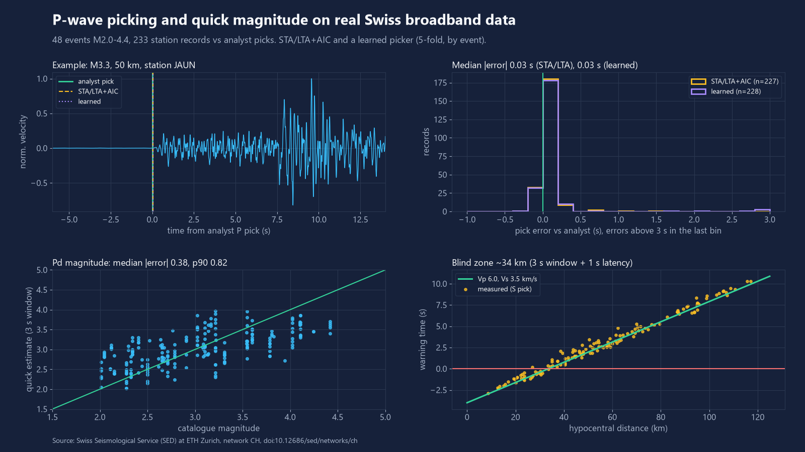
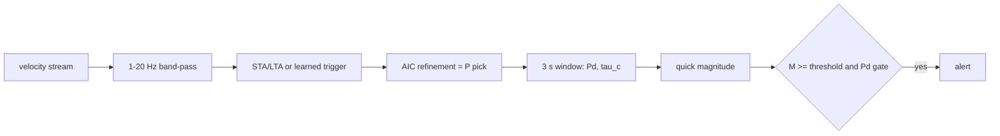

# p-wave-picker-lab

P-wave pickers, a 3-second magnitude estimate and an alert rule for low-cost seismic nodes, benchmarked against analyst picks on real Swiss earthquakes.



## What it does

- **Pickers:** energy STA/LTA trigger with AIC refinement (classic), and one small learned picker (logistic regression on five STA/LTA-style features, CPU only). A recursive O(1)-state STA/LTA is included for streaming on small nodes.
- **Quick magnitude:** peak displacement `Pd` and `tau_c` from the first 3 s after the pick. Two least-squares relations: `M = a + b*log10(Pd) + c*log10(R)` (needs a distance from a network) and `M = a + b*log10(tau_c)` (single node, no distance).
- **Alert rule:** alert when a trigger is followed by a quick magnitude above a threshold and a peak-displacement gate. A warning-time function gives seconds of warning at a given distance.
- **Benchmark:** `python -m pwave demo` fetches real data and reproduces the table below.

## Results

Measured by `python -m pwave eval` (full output in [`docs/results.json`](docs/results.json)).

Data: 48 local Swiss earthquakes M2.0-M4.4 (2021-02 to 2026-10), 233 vertical broadband records from 10 stations at 9-120 km hypocentral distance. Noise: 48 one-hour records (2.0 station-days) at 6 stations, random times 2024-01 to 2026-09, with no catalogue event of M1 or more in the region within 15 min before / 75 min after the hour start. Truth: the catalogue's manual P picks.

| Metric | STA/LTA + AIC | Learned picker |
|---|---|---|
| Pick rate (pick within -2 s / +10 s of analyst pick) | 97.4% (227/233) | 97.9% (228/233) |
| Pick error, median abs | 0.032 s | 0.032 s |
| Pick error, p90 abs | 0.158 s | 0.173 s |
| Within 0.5 s of analyst pick | 98.2% | 96.9% |
| False triggers on noise records | 5.5 per station-day | 6.0 per station-day |

The learned picker is scored out-of-fold (5-fold, grouped by event; noise records split the same way). STA/LTA settings (STA 1.0 s, LTA 10 s, on-ratio 30) and the learned probability threshold (0.995) are the lowest false-trigger setting that still finds at least 97% of analyst picks.

| Quick magnitude (3 s window, leave-one-event-out) | Value |
|---|---|
| Pd model, median abs error / p90 | 0.38 / 0.82 magnitude units (n = 227 records) |
| Pd model, event-level (median over stations) | 0.38 / 0.78 (n = 46 events) |
| tau_c model (no distance), median abs error / p90 | 0.44 / 1.04 |
| Always guess the median magnitude (reference) | 0.52 |
| Alert rule, M >= 3.0 recall / M < 3.0 false-alert rate | 77.5% / 23.4% (120 / 107 records) |
| False alerts on noise (assumed distance 63 km) | 2.5 per station-day |

Warning time = analyst S-wave pick minus (detected P pick + 3 s window + 1 s latency), by hypocentral distance:

| Distance | Measured median | Share with warning > 0 | Theory (Vp 6.0, Vs 3.5 km/s) |
|---|---|---|---|
| 0-25 km (n=20) | -1.2 s | 0% | -1.0 s at 25 km |
| 25-50 km (n=47) | 1.0 s | 74% | 2.0 s at 50 km |
| 50-75 km (n=41) | 3.3 s | 100% | 4.9 s at 75 km |
| 75-125 km (n=36) | 7.5 s | 100% | 7.9 s at 100 km |

The blind zone (alert after the S wave) is about 34 km for a 4 s total delay.

## Quick start

```bash
uv venv .venv --python 3.12
uv pip install --python .venv/Scripts/python.exe -e ".[dev]"   # Linux/macOS: .venv/bin/python
.venv/Scripts/python.exe -m pytest -q
.venv/Scripts/python.exe -m pwave demo      # fetch (about 20 min, ~140 MB in cache/), evaluate, redraw figures
```

`python -m pwave fetch` only downloads; `python -m pwave eval` re-runs the benchmark on the cache and writes `docs/results.json`, `docs/figure.png`, `docs/post-figure.png`.

## How it works



- STA/LTA compares short-term to preceding long-term energy; AIC then moves the trigger to the sample where the variance changes most.
- The learned picker classifies 0.1 s steps (log STA/LTA at 0.25 / 1 / 2.5 s, log RMS, ratio slope) as "onset" or "noise", needs three consecutive steps above the threshold, then applies the same AIC step.
- Pd and tau_c come from the displacement obtained by causal integration plus a 0.075 Hz high-pass. Regression coefficients are fitted on the event set (see `docs/results.json`).
- Warning time is `R/Vs - (R/Vp + window + latency)`.

## Data sources

- Catalogue picks, magnitudes and waveforms: Swiss Seismological Service (SED) at ETH Zurich, network CH, via the FDSN web services (`Client("ETH")` in ObsPy), fetched 2026-11-09. Station metadata marks the network `restrictedStatus="open"`.
- Citation requested for the network DOI: Swiss Seismological Service (SED) At ETH Zurich (1983). *National Seismic Networks of Switzerland*. ETH Zurich. https://doi.org/10.12686/sed/networks/ch
- Licence: no explicit data licence could be verified (the DataCite record for the DOI has no rights entry and the network page states none). So **no waveforms or catalogue rows are committed**. `pwave fetch` downloads them into the gitignored `cache/`; the repository holds code, aggregate results and figures only. Check the service's current terms before redistributing the data.
- Magnitudes are the catalogue's preferred magnitude (local magnitude types). Waveforms are converted to ground velocity with the station response.

## What is not verified yet

- Not a certified early-warning system, and not tested on a live stream or on low-cost sensors. The data are research-grade broadband records.
- Small event set: 48 events, 10 stations, one region; 12 events M2.0-2.5, 24 M2.5-3.5, 12 M3.5-4.5.
- Thresholds are tuned on the same data used for reporting (STA/LTA on and STA length; learned probability threshold; the alert's Pd gate, set to the 10th percentile of event Pd). Only the learned model weights and the magnitude relations are cross-validated.
- On event records the picker starts searching 2 s before the analyst pick, so the pick rate does not count early triggers in the pre-event part of the record; false triggers are measured separately on the noise records.
- False triggers are counted on 2 station-days of screened but not manually inspected noise, so some may be real small events, blasts or instrument glitches.
- The alert-on-noise figure uses an assumed distance (median event distance), because a lone node has no location.
- Analyst picks come from a network with processing of its own (some may be AIC-assisted), which can flatter agreement.

## Licence

MIT, see [LICENSE](LICENSE). Code only; the data keep their own terms.
